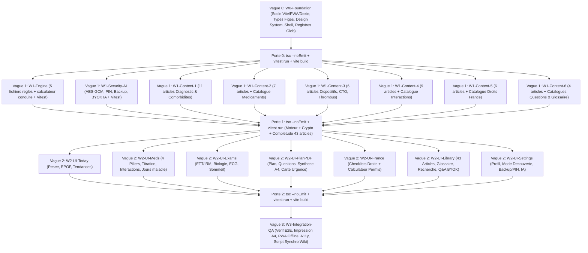

# Specification de Conception et d'Architecture -- Compagnon Cardiomyopathie Ischemique (PWA France)

> **Statut :** Specification d'architecture optimisee pour execution parallele multi-agents
> **Date :** 24 novembre 2026
> **Langue cible :** Francais (public et systeme de sante francais + recommandations europeennes ESC)
> **Source scientifique de reference :** Wiki local (`WIKI_ROOT`, par ex. `~/Documents/wiki/topics/ischaemic-cardiomyopathy` ; 42 articles compiles dans `wiki/` + 1 playbook dans `output/`, bases sur ESC 2026, ESC 2024 CCS, ESC/EACTS 2025, HFA 2024, HAS, Assurance Maladie / Ameli, Service-Public, Arrete du 28 mars 2022)
> **Manifeste de contenu associe :** [Manifeste de decoupage du wiki (6 lots / 43 fichiers)](./wiki-sharding-manifest.md)

---

## 1. Vision, Public Cible et Invariants Globaux

### 1.1 Objectif produit
Concevoir une **Progressive Web App (PWA)** privee, personnelle et familiale, entierement en francais, qui transforme l'ensemble des connaissances scientifiques et pratiques du wiki `ischaemic-cardiomyopathy` en un **compagnon quotidien de suivi et de dialogue avec l'equipe medicale**.

L'application poursuit quatre objectifs indivisibles :
1. **Informer exclusivement sur des bases scientifiques** : chaque information, seuil, tableau comparatif ou recommandation cite explicitement sa source (ESC 2026, essais cliniques, HAS, Ameli) ainsi que son niveau de preuve (Classe I, IIa, IIb, III) et ses limites ou incertitudes.
2. **Suivre toutes les donnees personnelles essentielles** : poids matinal, tension arterielle, frequence cardiaque, symptomes (grille EPOF), traitements de fond et titration des doses, examens biologiques, imagerie cardiaque (ETT et IRM distinguees), ECG, sommeil et demarches administratives francaises.
3. **Produire des plans, alertes et questions sur mesure** : un moteur deterministe local adapte dynamiquement les priorites de suivi, les alertes de vigilance et les questions a poser en consultation selon le profil reel du patient.
4. **Soutenir la vie quotidienne en France** : integrer nativement les dispositifs francais (ALD 5 / ALD 13, protocole de soins, readaptation cardiaque SMR, PRADO, telesurveillance IC, reforme des arrets de travail d'octobre 2026, temps partiel therapeutique, RQTH, AERAS / Loi Lemoine, regles francaises du permis de conduire).

### 1.2 Public et posture reglementaire
- **Usage :** Compagnon prive personnel ou cercle familial restreint (usage individuel sur les appareils de l'utilisateur).
- **Posture strictement non medicale / non DM (Dispositif Medical) :**
  - L'application est un outil d'auto-suivi, d'organisation et d'information scientifique.
  - Elle **ne pose pas de diagnostic**, **ne prescrit pas** et **ne demande jamais d'arreter ou modifier une dose de medicament sans avis medical**.
  - Les seuils cliniciens issus de la litterature (par exemple les paliers de creatinine ou de potassium) sont explicitement presentes comme des reperes pour comprendre les decisions de l'equipe medicale, jamais comme des consignes d'auto-ajustement.
  - En cas de signe d'alarme, le triage oriente clairement selon trois niveaux adaptes a la France :
    - **Vert (`stable`)** : poursuite du suivi habituel.
    - **Orange (`warning`)** : contacter rapidement le medecin traitant, l'infirmiere insuffisance cardiaque / IPA ou le cardiologue.
    - **Rouge (`urgent`)** : appeler le **15 (SAMU)** ou le **112** (ou **114** par SMS pour les personnes sourdes ou malentendantes).

### 1.3 Invariants Globaux & Contrat Editorial (Obligatoires pour tous les agents)
Tout agent intervenant sur le code, les regles, l'UI ou le contenu doit respecter sans exception :
1. **Exclusion absolue de `raw/` :** Ne jamais lire, indexer, citer ni copier aucun fichier de `<WIKI_ROOT>/raw/` (contient des documents personnels prives). Le depot ne contient que des connaissances scientifiques generales et un profil fictif anonymise pour le *Mode decouverte*.
2. **Langue et ton :** Francais idiomatique, **vouvoiement** systematique (`vous`, `votre cardiologue`), ton calme, factuel et non alarmiste.
3. **Unites et formatage francais :** Virgule decimale a l'affichage (`0,55 g/L`, `2,0 kg`), LDL en **g/L** en priorite (equivalence `mmol/L` en secondaire), creatinine en `umol/L` (avec aide de conversion `mg/L`), poids en `kg`, TA en `mmHg`, FC en `bpm`.
4. **Terminologie uniforme :** Respect strict du glossaire partage dans [wiki-sharding-manifest.md](./wiki-sharding-manifest.md) (`FEVG`, `ICFER`, `ARM`, `iSGLT2`, `CST`, `DFGe`, `DAI`, `ETT` vs `IRM`, DCI + nom commercial francais).
5. **Reperes francais uniquement :** Urgences `15` / `112` / `114`, interlocuteurs francais (`medecin traitant`, `cardiologue`, `IPA`, `pharmacien`, `medecin du travail`, `medecin agree`), sources `ameli.fr` / `service-public.fr` / `HAS`. Les mentions UK/US ne subsistent que dans les sections comparatives explicites.
6. **Zero emoji :** Aucun emoji dans le code, l'interface, les tests, les articles ou la documentation. Utiliser exclusivement `lucide-react`.
7. **Bandeau d'avertissement reutilisable :** Tout ecran clinique ou juridique affiche le composant partage `<DisclaimerBanner variant="medical" | "legal" />` fourni en Wave 0.

---

## 2. Architecture Technique, Stockage Local-First & Anti-Conflits

### 2.1 Stack technologique
| Couche | Technologie | Justification |
|---|---|---|
| Framework UI | **React 19 + TypeScript (strict)** | Typage strict partage entre moteur, contenu et UI |
| Build & Bundling | **Vite** | Demarrage rapide, `import.meta.glob`, build statique leger |
| Styles | **Tailwind CSS v4** | Design system editorial clair, mode sombre, mode *Texte agrandi* et `@media print` |
| Stockage local | **Dexie.js (IndexedDB)** | Persistance locale structuree, migrations versionnees, 100 % hors ligne |
| PWA & Hors ligne | **vite-plugin-pwa (Workbox)** | Installation ecran d'accueil, precache complet de l'application et des 43 articles |
| Visualisation | **Recharts** | Courbes responsives de poids, TA/FC, NT-proBNP, FEVG (ETT/IRM separees), LDL-c |
| Iconographie | **lucide-react** | Icones vectorielles sobres (zero emoji) |
| Chiffrement sauvegarde | **Web Crypto API** (`PBKDF2` + `AES-GCM`) | Sauvegardes chiffrees par mot de passe sans dependance cryptographique tierce |
| Tests | **Vitest + Testing Library** | Verification unitaire exhaustive du moteur de regles, du chiffrement et du manifeste de contenu |

### 2.2 Strategie donnees, vie privee et perennite
- **Zero backend :** Application 100 % statique ; aucune donnee de sante ne quitte l'appareil par defaut.
- **Profil actif + Mode decouverte :**
  - Base active IndexedDB `CardioCompagnonDB` (profil actif unique).
  - Un **Mode decouverte** integre bascule sur une base separee `CardioCompagnonDemoDB` pre-remplie par un jeu de donnees fictif francais realiste (jamais de risque d'ecrasement des donnees reelles), signale par un bandeau permanent en haut d'ecran.
- **Verrouillage local optionnel :** Code PIN optionnel verifie via `PBKDF2` sale localement (`AppSettings.pinHash`).
- **Sauvegarde et restauration en un clic :**
  - Export JSON clair (`.cardio.json`) ou chiffre (`PBKDF2` + `AES-GCM`, `.cardio.enc.json`), excluant par defaut la cle API BYOK.
  - Import avec validation stricte de schema et apercu avant confirmation.
  - Rappel discret dans l'interface si `lastBackupAt` depasse 14 jours.

### 2.3 Assistant IA optionnel (BYOK -- Bring Your Own Key)
Strictement **desactive par defaut** et jamais requis pour les alertes, les seuils ou le plan de suivi (qui restent 100 % deterministes et hors ligne).
- **Fournisseurs supportes (adaptateur client agnostique `AiProviderAdapter`) :**
  - API **Gemini** (support natif PDF/image + CORS navigateur) ;
  - API **Mistral** ou tout endpoint **compatible OpenAI** ;
  - Endpoint local **Ollama / LM Studio** (traitement 100 % local sur reseau domestique).
- **Deux capacites bornees :**
  1. **Extraction assistee de comptes-rendus (biologie, ETT, IRM, ordonnance)** : retourne un `ExtractionProposal` affiche dans un formulaire de verification ou l'utilisateur valide explicitement chaque champ avant ecriture dans Dexie.
  2. **Q&A documentaire ancree sur le wiki** : recherche locale TF-IDF / mots-cles sur les 43 articles francais embarques, puis synthese strictement limitee aux extraits fournis avec citations explicites (refus de prescrire ou modifier une dose).
- **Garde-fou vie privee :** Bandeau de consentement explicite avant tout appel externe, rappel de ne pas transmettre nom/prenom/NIR.

### 2.4 Architecture Anti-Conflits & Arborescence du Depot
Pour permettre l'execution simultanee de **6 a 8 agents en parallele** sans aucun conflit Git, le depot suit trois principes structurants :
1. **Contrats figes en Wave 0 :** `src/types/*`, `src/db/*`, `src/ui/*`, `src/app/routes.tsx` et `src/content/fr/index.ts` sont crees et verrouilles en Wave 0. Les agents de Wave 1 et Wave 2 les consomment en **lecture seule**.
2. **Auto-decouverte via `import.meta.glob` :**
   - Les 43 articles francais vivent chacun dans leur fichier `src/content/fr/articles/<slug>.ts` et sont charges dynamiquement par `src/content/fr/index.ts` (`import.meta.glob('./articles/*.ts', { eager: true })`). Aucun agent de contenu ne touche un index commun.
   - Les 5 fichiers de regles (`src/engine/rules/*.rules.ts`) sont importes par un seul orchestrateur dans `W1-Engine`.
3. **Frontieres strictes par module UI (`src/features/<feature>/`) :**
   - `src/app/routes.tsx` (Wave 0) declare des imports paresseux (`React.lazy`) pointant vers des points d'entree figes (`src/features/today/index.ts`, `src/features/meds/index.ts`, `src/features/exams/index.ts`, `src/features/plan/index.ts`, `src/features/france/index.ts`, `src/features/library/index.ts`, `src/features/settings/index.ts`) contenant initialement un squelette minimal (`export { TodayPage as default }`).
   - En Wave 2, chaque agent UI ne modifie **que** son repertoire `src/features/<feature>/`.

```text
cardio-app/
├── docs/
│   ├── design-spec.md                 # Ce document (architecture, contrats, DAG)
│   └── wiki-sharding-manifest.md      # Decoupage 6 lots / 43 articles + glossaire FR
├── scripts/
│   └── check-wiki-sync.ts             # [W3] Verification de synchro avec le wiki source
├── src/
│   ├── types/                         # [W0 - GELE apres W0] Contrats TypeScript canoniques
│   │   ├── domain.ts
│   │   ├── rules.ts
│   │   ├── content.ts
│   │   ├── ai.ts
│   │   ├── backup.ts
│   │   └── index.ts
│   ├── db/                            # [W0 - GELE apres W0] Dexie, hooks, profil demo
│   │   ├── database.ts
│   │   ├── demo-seed.ts
│   │   ├── state-loader.ts            # Charge PatientState complet pour le moteur
│   │   └── index.ts
│   ├── ui/                            # [W0 - GELE apres W0] Design system, layout, composants communs
│   │   ├── theme.css                  # Tokens clair/sombre, Texte agrandi, @media print A4
│   │   ├── AppShell.tsx               # Nav mobile + sidebar desktop + bandeau Demo + bouton Urgence
│   │   ├── DisclaimerBanner.tsx
│   │   ├── TriageBadge.tsx
│   │   ├── EvidenceBadge.tsx
│   │   ├── GlossaryTooltip.tsx
│   │   ├── Card.tsx
│   │   └── index.ts
│   ├── app/                           # [W0 - GELE apres W0, ajuste si besoin en W3]
│   │   ├── routes.tsx                 # Lazy routes vers src/features/*
│   │   └── App.tsx
│   ├── engine/                        # [W1-Engine] Moteur deterministe pur + Vitest
│   │   ├── rules/
│   │   │   ├── daily-vitals.rules.ts
│   │   │   ├── medications.rules.ts
│   │   │   ├── labs-imaging.rules.ts
│   │   │   ├── french-rights.rules.ts
│   │   │   └── driving.rules.ts
│   │   ├── evaluate.ts                # evaluatePatientState(state): EngineEvaluation
│   │   ├── driving-calculator.ts      # evaluateFrenchDrivingFitness(input)
│   │   ├── units.ts                   # Conversions LDL g/L <-> mmol/L, creat umol/L <-> mg/L
│   │   ├── __tests__/                 # Suite Vitest exhaustive
│   │   └── index.ts
│   ├── services/                      # [W1-Security-AI] Crypto, PIN, Backup, BYOK AI
│   │   ├── crypto.ts
│   │   ├── backup.ts
│   │   ├── pin-lock.ts
│   │   ├── ai/
│   │   │   ├── adapter.ts
│   │   │   ├── gemini.adapter.ts
│   │   │   ├── openai-compat.adapter.ts
│   │   │   ├── ollama.adapter.ts
│   │   │   ├── extract-report.ts
│   │   │   └── wiki-qa.ts
│   │   ├── __tests__/
│   │   └── index.ts
│   ├── content/fr/                    # [W0 index + W1-Content-1..6]
│   │   ├── expected-slugs.ts          # [W0] Liste figee des 43 ArticleSlug
│   │   ├── index.ts                   # [W0] Auto-chargeur import.meta.glob + recherche locale
│   │   ├── __tests__/manifest.test.ts # [W0] Test de completude 43 articles + 5 catalogues
│   │   ├── articles/                  # [W1-Content-1..6] 43 fichiers <slug>.ts disjoints
│   │   └── catalogs/
│   │       ├── medications-reference.ts  # [W1-Content-2]
│   │       ├── interactions-catalog.ts   # [W1-Content-4]
│   │       ├── french-admin-catalog.ts   # [W1-Content-5]
│   │       ├── questions-catalog.ts      # [W1-Content-6]
│   │       └── glossary.ts               # [W1-Content-6]
│   └── features/                      # [W2 - 1 repertoire exclusif par agent UI]
│       ├── today/                     # [W2-UI-Today]
│       ├── meds/                      # [W2-UI-Meds]
│       ├── exams/                     # [W2-UI-Exams]
│       ├── plan/                      # [W2-UI-PlanPDF]
│       ├── france/                    # [W2-UI-France]
│       ├── library/                   # [W2-UI-Library]
│       └── settings/                  # [W2-UI-Settings]
```

---

## 3. Perimetre Clinique Dynamique

L'application modelise en profondeur la **cardiomyopathie ischemique a fraction d'ejection reduite (ICFER / HFrEF)** ainsi que ses evolutions (**Stade B asymptomatique** et **FEVG amelioree / HFimpEF**).

Le profil clinique active dynamiquement des **modules optionnels** (`PatientProfile.modules`) correspondant aux situations documentees dans le wiki :

| Cle (`ClinicalModuleKey`) | Situation clinique | Impact dynamique dans l'application |
|---|---|---|
| `hfImpEf` | FEVG amelioree (>= 40 % apres <= 40 %) | Rappel ESC 2026 Classe I de poursuite des traitements meme apres recuperation |
| `cto` | Occlusion coronaire chronique (CTO) | Questions viabilite/ischemie, Heart Team, risques PROGRESS-CTO, pontage/MIDCAB |
| `aorticStenosis` | Retrecissement aortique | Suivi surface valvulaire / gradient / SVi, alerte bas debit, surveillance annuelle |
| `lvThrombusOrAneurysm` | Thrombus VG / anevrisme VG | Suivi anticoagulation (3-6 mois + imagerie de controle), ETT vs IRM |
| `atrialFibrillation` | Fibrillation atriale (FA) | Score CHA2DS2-VA, nuance NT-proBNP (+50 a +100 %), inapplicabilite ivabradine hors rythme sinusal |
| `ckd` | Maladie renale chronique (DFGe < 60) | Suivi renforce creatinine/DFGe/K+, seuils ARM/iSGLT2, nuance NT-proBNP |
| `diabetes` | Diabete | Alerte acidocetose sous iSGLT2 en maladie aigue/jeune, hypoglycemie masquee sous BB, discussion finerenone si MRC + DT2 |
| `sleepApnoea` | Apnee du sommeil (`osa` / `csa` / `suspected`) | Suivi IAH, remboursement PPC (HAS), contre-indication formelle ASV si SACS + ICFER (SERVE-HF) |
| `lifeVest` | Gilet defibrillateur portable | Suivi duree de port, reevaluation 3-6 mois, **interdiction legale de conduire en France** (Arrete 2022 §1.2.6) |
| `device` | DAI / CRT-P / CRT-D | Regles de conduite post-implant/choc, telesurveillance de prothese, anticipation fin de vie |

---

## 4. Architecture Fonctionnelle des 6 Modules (+ Parametres)

- **Module 1 -- Aujourd'hui (`src/features/today/`) :** pesee matinale < 15 s (comparaison poids sec et 3 jours glissants), TA/FC, grille **EPOF** (*Essoufflement*, *Prise de poids*, *Oedemes*, *Fatigue*) + signes complementaires, bandeau triage 3 niveaux, prise medicamenteuse optionnelle, graphiques 7/30/90 jours.
- **Module 2 -- Traitements & Securite (`src/features/meds/`) :** tableau des 4 piliers ESC 2026 vs doses cibles, historique de titration (`DoseChangeEvent`) + rappel bilan renal/K+ a 1-2 semaines, diuretiques/prevention secondaire/add-ons, verificateur interactif *Securite, Complements & Interactions* filtre sur les classes actives, fiche personnalisable *Jours de maladie*.
- **Module 3 -- Examens & Chiffres (`src/features/exams/`) :** imagerie cardiaque avec **separation stricte ETT vs IRM** (FEVG, VTDi/VTSi par sexe et modalite, cicatrice LGE, valve aortique, thrombus VG), biologie (NT-proBNP vs BNP + avertissement ARNI, creatinine/DFGe/K+ + pseudo-aggravation, ferritine/CST, LDL en g/L + mmol/L + baisse >= 50 %, Lp(a), HbA1c, NFS, TSH, digoxinemie), ECG (rythme, QRS, BBG), sommeil (IAH), import assiste BYOK optionnel.
- **Module 4 -- Mon Plan & Consultations (`src/features/plan/`) :** plan de suivi deterministe priorise, preparateur de consultation avec questions filtrees par interlocuteur (*Cardiologue*, *Medecin traitant*, *Pharmacien*, *Medecin du travail*) et notes de reponses, **Fiche de synthese cardiologique A4 imprimable/PDF** (`@media print`), et **Carte de suivi / Urgence** accessible en 1 clic depuis l'en-tete.
- **Module 5 -- Vie en France & Droits (`src/features/france/`) :** checklists interactives (`A faire` / `En cours` / `Obtenu`) pour ALD 5/13, readaptation SMR, PRADO, telesurveillance IC, arret de travail (reforme octobre 2026 1 an vs 3 ans ALD), reprise du travail (pre-reprise, TPT, essai encadre, CRPE, RQTH, invalidite), emprunt (Loi Lemoine / AERAS), vaccinations + **calculateur interactif Permis de conduire en France** (Arrete du 28 mars 2022).
- **Module 6 -- Bibliotheque Scientifique (`src/features/library/`) :** lecteur des 43 articles francais classes par categorie avec badges de preuve/volatilite/`asOf`, glossaire interactif, recherche plein texte 100 % hors ligne, et Q&A documentaire BYOK optionnel.
- **Module 7 -- Parametres & Profil (`src/features/settings/`) :** assistant de profil clinique (activation des modules), bascule *Mode decouverte*, sauvegarde/restauration JSON clair ou chiffre `AES-GCM`, code PIN local, theme clair/sombre, *Texte agrandi*, activation de la prise quotidienne des medicaments, et configuration BYOK IA.

---

## 5. Contrats TypeScript Figes (Wave 0) et Registres d'IDs

Les interfaces ci-dessous sont creees **verbatim** en Wave 0 dans `src/types/` et constituent le contrat compile entre tous les agents paralleles.

### 5.1 Contrats de domaine (`src/types/domain.ts`)

```ts
export type ClinicalModuleKey =
  | 'hfImpEf'
  | 'cto'
  | 'aorticStenosis'
  | 'lvThrombusOrAneurysm'
  | 'atrialFibrillation'
  | 'ckd'
  | 'diabetes'
  | 'sleepApnoea'
  | 'lifeVest'
  | 'device';

export type SleepApnoeaStatus = 'none' | 'osa' | 'csa' | 'suspected';
export type CardiacDeviceType = 'none' | 'icd_primary' | 'icd_secondary' | 'crt_p' | 'crt_d';

export interface CareContact {
  name: string;
  phone?: string;
  center?: string;
}

export interface PatientProfile {
  id: 'active';
  displayName?: string;
  sex: 'M' | 'F';
  birthYear?: number;
  diagnosisDate?: string;                 // YYYY-MM-DD
  hfStage: 'B' | 'C' | 'unknown';
  nyhaClass: 1 | 2 | 3 | 4 | null;
  ischaemicCauseConfirmed: 'yes' | 'uncertain' | 'mixed';
  dryWeightKg?: number;
  baselineLdlGL?: number;                 // LDL avant traitement hypolipemiant (g/L)
  fluidLimitMl?: number | null;           // null = selon la soif (FRESH-UP / HFA 2024)
  saltTargetG?: number;                   // defaut repere 5 g/j
  drivingGroup: 'group1' | 'group2' | 'none';
  onExtendedSickLeave?: boolean;          // Pour alerte reforme IJ octobre 2026
  modules: {
    hfImpEf: boolean;
    cto: boolean;
    aorticStenosis: boolean;
    lvThrombusOrAneurysm: boolean;
    atrialFibrillation: boolean;
    ckd: boolean;
    diabetes: boolean;
    sleepApnoea: SleepApnoeaStatus;
    lifeVest: boolean;
    device: CardiacDeviceType;
  };
  careTeam: {
    cardiologist?: CareContact;
    gp?: CareContact;
    hfNurse?: CareContact;
    pharmacist?: CareContact;
    trustedContact?: CareContact;
  };
  sickDayPlanNote?: string;
  allergies?: string;
  updatedAt: string;                      // ISO 8601
}

export interface DailyLog {
  id?: number;
  date: string;                           // YYYY-MM-DD (index unique)
  weightKg?: number;
  systolicBp?: number;
  diastolicBp?: number;
  heartRateBpm?: number;
  symptoms: {
    dyspnoea: 'none' | 'exertion' | 'rest_or_lying';
    oedema: 'none' | 'mild' | 'worsening';
    fatigue: 'none' | 'moderate' | 'severe';
    dizziness: boolean;
    palpitations: boolean;
    chestPain: boolean;
    persistentCough: boolean;
    appetiteLoss: boolean;
  };
  notes?: string;
  createdAt: string;
}

export type MedicationPillar =
  | 'raas_arni'
  | 'beta_blocker'
  | 'mra'
  | 'sglt2i'
  | 'loop_diuretic'
  | 'lipid_lowering'
  | 'antiplatelet'
  | 'anticoagulant'
  | 'addon_hf'
  | 'other';

export type MedicationSubClass =
  | 'ace_i'
  | 'arb'
  | 'arni'
  | 'beta_blocker'
  | 'steroidal_mra'
  | 'non_steroidal_mra'
  | 'sglt2i'
  | 'loop_diuretic'
  | 'statin'
  | 'ezetimibe'
  | 'pcsk9'
  | 'aspirin_p2y12'
  | 'colchicine'
  | 'anticoagulant'
  | 'ivabradine'
  | 'digoxin_digitoxin'
  | 'vericiguat'
  | 'potassium_binder'
  | 'other';

export type ScheduleSlot = 'matin' | 'midi' | 'soir' | 'coucher';

export interface Medication {
  id?: number;
  pillar: MedicationPillar;
  subClass?: MedicationSubClass;
  innName: string;                        // DCI (ex: "sacubitril/valsartan")
  frenchBrand?: string;                   // Ex: "Entresto"
  doseLabel: string;                      // Ex: "49/51 mg x 2/j"
  dosePercentOfTarget?: number;           // 0-100
  status: 'active' | 'titrating' | 'at_target' | 'paused' | 'stopped';
  notPrescribedReason?: string;           // Ex: "contre-indication renale", "intolerance"
  switchedFromAceIAt?: string;            // ISO date si passage IEC -> ARNI (regle 36 h)
  startedAt?: string;
  lastDoseChangeAt?: string;              // YYYY-MM-DD
  scheduleSlots?: ScheduleSlot[];
  sideEffectsNote?: string;
}

export interface DoseChangeEvent {
  id?: number;
  medicationId: number;
  date: string;                           // YYYY-MM-DD
  previousDoseLabel?: string;
  newDoseLabel: string;
  reason?: string;
}

export interface MedicationIntakeLog {
  id?: number;
  date: string;                           // YYYY-MM-DD
  medicationId: number;
  slot: ScheduleSlot;
  taken: boolean;
  takenAt?: string;
}

export interface LabResult {
  id?: number;
  date: string;                           // YYYY-MM-DD
  ntProBnpPgMl?: number;
  bnpPgMl?: number;
  creatinineUmolL?: number;
  egfrMlMin?: number;
  potassiumMmolL?: number;
  sodiumMmolL?: number;
  ferritinUgL?: number;
  tsatPercent?: number;                   // CST (%)
  ldlGL?: number;                         // g/L
  lpaValue?: number;
  lpaUnit?: 'nmol/L' | 'mg/dL';
  haemoglobinGDl?: number;
  hba1cPercent?: number;
  tshMiuL?: number;
  digoxinNgMl?: number;
  notes?: string;
}

export interface ImagingExam {
  id?: number;
  date: string;                           // YYYY-MM-DD
  modality: 'ett' | 'irm';
  lvefPercent?: number;
  lveddMm?: number;
  lvedviMlM2?: number;
  lvesviMlM2?: number;
  lgeScarPresent?: boolean;
  lgeScarPercent?: number;
  lgePattern?: 'subendocardial_transmural' | 'midwall' | 'epicardial' | 'mixed' | 'none';
  aorticValveAreaCm2?: number;
  aorticMeanGradientMmHg?: number;
  strokeVolumeIndexMlM2?: number;
  mitralRegurgitation?: 'none' | 'mild' | 'moderate' | 'severe';
  lvThrombus?: 'absent' | 'present' | 'uncertain';
  notes?: string;
}

export type ClinicalEventType =
  | 'mi'
  | 'pci_stent'
  | 'cabg'
  | 'hf_hospitalisation'
  | 'icd_implant'
  | 'icd_shock_appropriate'
  | 'icd_shock_inappropriate'
  | 'iv_iron_infusion'
  | 'ecg_check'
  | 'sleep_study'
  | 'vaccine_flu'
  | 'vaccine_pneumo'
  | 'consultation';

export interface ClinicalEvent {
  id?: number;
  date: string;                           // YYYY-MM-DD
  type: ClinicalEventType;
  details: Record<string, string | number | boolean>;
  notes?: string;
}

export interface QuestionTracking {
  questionId: string;                     // Cle primaire
  selectedForNextVisit: boolean;
  status: 'open' | 'asked' | 'resolved' | 'not_applicable';
  answerNote?: string;
  answeredAt?: string;
}

export type FrenchAdminItemId =
  | 'ald_5_13'
  | 'smr_rehab'
  | 'prado_ic'
  | 'telesurveillance_ic'
  | 'arret_travail_ij'
  | 'visite_pre_reprise'
  | 'temps_partiel_therapeutique'
  | 'rqth_mdph'
  | 'pension_invalidite'
  | 'emprunt_aeras_lemoine'
  | 'permis_medecin_agree'
  | 'vaccinations_ic';

export interface FrenchAdminProgress {
  itemId: FrenchAdminItemId;              // Cle primaire
  status: 'todo' | 'in_progress' | 'done' | 'not_applicable';
  renewalDate?: string;
  notes?: string;
}

export interface AppSettings {
  id: 'settings';
  theme: 'light' | 'dark' | 'system';
  largeTextMode: boolean;
  enableDailyPillCheckin: boolean;
  pinHash?: string;
  pinSalt?: string;
  lastBackupAt?: string;
  aiHelper: {
    enabled: boolean;
    provider: 'gemini' | 'mistral' | 'openai_compatible' | 'ollama';
    endpointUrl?: string;
    modelName?: string;
    apiKey?: string;
  };
}

export interface PatientState {
  profile: PatientProfile;
  dailyLogs: DailyLog[];                  // Trie par date croissante
  medications: Medication[];
  doseChanges: DoseChangeEvent[];
  labs: LabResult[];                      // Trie par date croissante
  imaging: ImagingExam[];                 // Trie par date croissante
  events: ClinicalEvent[];                // Trie par date croissante
  adminProgress: FrenchAdminProgress[];
  referenceDate: string;                  // YYYY-MM-DD (injecte pour determinisme des tests)
}
```

### 5.2 Contrats du Moteur Deterministe (`src/types/rules.ts`)

```ts
export type RuleId =
  | 'WEIGHT_GAIN_3D'
  | 'EPOF_RED_FLAG'
  | 'EPOF_WORSENING'
  | 'UNPLANNED_WEIGHT_LOSS'
  | 'LOW_BP_SYMPTOMATIC'
  | 'LOW_BP_ASYMPTOMATIC'
  | 'HR_IVABRADINE_DISCUSSION'
  | 'GDMT_MISSING_PILLAR'
  | 'STAGE_B_CONTEXT'
  | 'HFIMPEF_CONTINUE'
  | 'POST_TITRATION_LABS'
  | 'ARNI_WASHOUT_INFO'
  | 'POTASSIUM_ALERT'
  | 'CREATININE_JUMP'
  | 'CONTRAINDICATED_DRUG'
  | 'SGLT2_KETO_REMINDER'
  | 'BNP_ON_ARNI_CAVEAT'
  | 'ETT_VS_IRM_DISCORDANCE'
  | 'IRON_DEFICIENCY_CHECK'
  | 'LDL_TARGET_GAP'
  | 'LPA_ONE_OFF'
  | 'ICD_REASSESSMENT_3M'
  | 'CRT_QRS_DISCUSSION'
  | 'AS_LOW_FLOW_CAVEAT'
  | 'CSA_ASV_CONTRAINDICATION'
  | 'FR_ALD_CHECK'
  | 'FR_SMR_REHAB'
  | 'FR_TELESURVEILLANCE'
  | 'FR_SICK_LEAVE_2026'
  | 'FR_DRIVING_LIFEVEST'
  | 'FR_DRIVING_ICD_OR_NYHA'
  | 'VACCINES_ANNUAL';

export type RuleSeverity = 'info' | 'action' | 'warning' | 'urgent';
export type TriageLevel = 'stable' | 'warning' | 'urgent';
export type RuleCategory = 'daily' | 'medications' | 'exams' | 'devices' | 'france';

export interface RuleOutput {
  id: RuleId;
  severity: RuleSeverity;
  category: RuleCategory;
  titleFr: string;
  explanationFr: string;
  suggestedActionFr: string;
  evidenceGrade?: string;                 // Ex: "ESC 2026 Classe I", "HAS 2024", "Arrete 28 mars 2022"
  sources: string[];
  articleSlug: string;                    // Doit appartenir a EXPECTED_ARTICLE_SLUGS
  relatedQuestionIds?: string[];
}

export interface EngineEvaluation {
  triageLevel: TriageLevel;
  triageSummaryFr: string;
  outputs: RuleOutput[];                  // Trie par severite decroissante (urgent -> warning -> action -> info)
  prioritizedQuestionIds: string[];
}

export interface DrivingAssessmentInput {
  group: 'group1' | 'group2';
  nyhaClass: 1 | 2 | 3 | 4;
  lvefPercent?: number;
  hasLifeVest: boolean;
  device: 'none' | 'icd_primary' | 'icd_secondary' | 'crt_p' | 'crt_d';
  daysSinceMi?: number;
  daysSincePlannedPci?: number;
  daysSinceCabg?: number;
  daysSinceIcdImplant?: number;
  hadRecentShock?: 'none' | 'appropriate' | 'inappropriate';
}

export interface DrivingAssessmentResult {
  status: 'compatible_after_clearance' | 'temporarily_incompatible' | 'permanently_incompatible' | 'specialist_assessment_required';
  minWaitWeeks?: number;
  headlineFr: string;
  explanationFr: string;
  legalBasisFr: string;                   // Arrete du 28 mars 2022 + Directive UE 2016/1106
  nextStepsFr: string[];
}
```

### 5.3 Contrats de Contenu, IA & Sauvegarde (`src/types/content.ts`, `ai.ts`, `backup.ts`)

```ts
// src/types/content.ts
export type ArticleCategory =
  | 'diagnostic'
  | 'traitements'
  | 'dispositifs'
  | 'comorbidites'
  | 'nutrition'
  | 'quotidien'
  | 'france'
  | 'references';

export interface ArticleSection {
  headingFr: string;
  bodyMarkdownFr: string;
}

export interface WikiArticle {
  slug: string;                           // Correspond a EXPECTED_ARTICLE_SLUGS
  sourceWikiPath: string;                 // Ex: "wiki/topics/living-with-heart-failure-in-france.md"
  titleFr: string;
  category: ArticleCategory;
  asOf: string;                           // "2026-11-24"
  confidence: 'high' | 'medium-high' | 'medium';
  volatility: 'hot' | 'warm' | 'stable';
  tags: string[];
  aliases: string[];
  linkedModules: (ClinicalModuleKey | 'core' | 'stageB')[];
  plainSummaryFr: string;                 // Encadre "En clair"
  sections: ArticleSection[];
  relatedArticleSlugs: string[];
  sources: { label: string; detail: string }[];
  disclaimerType: 'medical' | 'legal_france';
}

export type QuestionInterlocutor = 'cardiologist' | 'gp' | 'pharmacist' | 'occupational_doctor';

export interface QuestionCatalogItem {
  id: string;                             // Ex: "q_meds_four_pillars"
  interlocutor: QuestionInterlocutor;
  topicFr: string;
  questionFr: string;
  whyItMattersFr: string;
  sources: string[];
  articleSlug: string;
  relevantModules: (ClinicalModuleKey | 'core' | 'stageB')[];
  triggeredByRules?: RuleId[];
}

export interface InteractionItem {
  id: string;
  nameFr: string;
  aliases: string[];
  verdict: 'worth_raising' | 'possible' | 'not_supported' | 'avoid';
  summaryFr: string;
  mechanismOrCaveatFr: string;
  affectedPillars: MedicationPillar[];
  evidenceGrade?: string;
  sources: string[];
  articleSlug: string;
}

export interface MedicationReference {
  id: string;
  pillar: MedicationPillar;
  subClass: MedicationSubClass;
  innNameFr: string;
  frenchBrands: string[];
  startDoseFr?: string;
  targetDoseFr?: string;
  titrationIntervalFr?: string;
  monitoringFr: string;
  avoidInHfref?: boolean;
  articleSlug: string;
}

export interface FrenchAdminCatalogItem {
  id: FrenchAdminItemId;
  titleFr: string;
  category: 'couverture' | 'parcours_soins' | 'travail' | 'emprunt' | 'conduite' | 'prevention';
  summaryFr: string;
  stepsFr: string[];
  officialLinks: { label: string; url: string }[];
  asOf: string;
  articleSlug: string;
}

export interface GlossaryTerm {
  id: string;
  termFr: string;
  aliases: string[];
  shortDefinitionFr: string;
  articleSlug?: string;
}
```

```ts
// src/types/ai.ts
export interface ExtractionProposal {
  kind: 'lab' | 'imaging' | 'medication';
  extractedFields: Record<string, string | number | boolean | undefined>;
  warningsFr: string[];
  rawModelNote?: string;
}

export interface WikiQaResponse {
  answerFr: string;
  citedArticles: { slug: string; titleFr: string }[];
  disclaimerFr: string;
}

export interface AiProviderAdapter {
  extractFromTextOrFile(input: { text?: string; fileBase64?: string; mimeType?: string }): Promise<ExtractionProposal>;
  answerFromWikiContext(questionFr: string, contextSnippets: { slug: string; titleFr: string; excerptFr: string }[]): Promise<WikiQaResponse>;
}

// src/types/backup.ts
export interface PlainBackupPayload {
  schemaVersion: 1;
  exportedAt: string;
  profile: PatientProfile;
  dailyLogs: DailyLog[];
  medications: Medication[];
  doseChanges: DoseChangeEvent[];
  intakeLogs: MedicationIntakeLog[];
  labs: LabResult[];
  imaging: ImagingExam[];
  events: ClinicalEvent[];
  questionTracking: QuestionTracking[];
  adminProgress: FrenchAdminProgress[];
}

export type BackupEnvelope =
  | { format: 'cardio-compagnon-plain-v1'; payload: PlainBackupPayload }
  | { format: 'cardio-compagnon-enc-v1'; kdf: 'PBKDF2-SHA256'; iterations: number; saltB64: string; ivB64: string; ciphertextB64: string };
```

---

## 6. Moteur de Regles Deterministe (Repartition en 5 Fichiers Purs)

Toutes les regles sont implementees par `W1-Engine` sous `src/engine/rules/` en fonctions pures sans effet de bord, avec tests Vitest couvrant chaque borne.

### 6.1 `daily-vitals.rules.ts`
| `RuleId` | Condition deterministe | Severite | Action & Source |
|---|---|---|---|
| `WEIGHT_GAIN_3D` | Hausse >= 2,0 kg sur 3 jours glissants ou >= 2,0 kg au-dessus de `dryWeightKg` | `warning` | Retention hydrosodee possible : contacter medecin traitant, infirmiere IC ou cardiologue (BHF / ESC) |
| `EPOF_RED_FLAG` | `chestPain` ou `dyspnoea === 'rest_or_lying'` ou malaise aigu note | `urgent` | Signes d'alarme aigus : appeler le **15 (SAMU)** ou **112** (ESC 2026) |
| `EPOF_WORSENING` | `dyspnoea === 'exertion'` nouveau/aggrave ou `oedema === 'worsening'` ou `fatigue === 'severe'` | `warning` | Aggravation EPOF : contacter l'equipe sous 24-48 h (ESC 2026) |
| `UNPLANNED_WEIGHT_LOSS` | Baisse >= 5 % sur 90-180 jours par rapport au poids stable precedent | `warning` | Risque denutrition / cachexie cardiaque : demander evaluation nutritionnelle (EFFORT-HF) |
| `LOW_BP_SYMPTOMATIC` | `systolicBp < 90` avec `dizziness === true` | `warning` | Hypotension symptomatique : ne pas arreter seul, contacter l'equipe (Skouri 2025 / Cautela 2020) |
| `LOW_BP_ASYMPTOMATIC` | `systolicBp < 100` sans vertiges | `info` | Tension basse bien toleree souvent acceptee pour maintenir les 4 piliers (Cautela 2020) |
| `HR_IVABRADINE_DISCUSSION` | `!atrialFibrillation` + derniere FEVG <= 35 % + BB `at_target` + FC moyenne repos > 70 bpm (> 75 AMM UE) | `action` | Evoquer l'ivabradine avec le cardiologue (ESC 2026 IIa / SHIFT / EMA) |

### 6.2 `medications.rules.ts`
| `RuleId` | Condition deterministe | Severite | Action & Source |
|---|---|---|---|
| `GDMT_MISSING_PILLAR` | `hfStage === 'C'` + pilier manquant parmi `raas_arni`, `beta_blocker`, `mra`, `sglt2i` sans `notPrescribedReason` | `action` | Question prioritaire : suis-je sous les 4 piliers ou y a-t-il une raison ? (ESC 2026 Classe I) |
| `STAGE_B_CONTEXT` | `hfStage === 'B'` | `info` | Stade B : preuves centrees sur IEC + BB (+ eplerenone post-IDM) (ESC 2026) |
| `HFIMPEF_CONTINUE` | `modules.hfImpEf === true` | `info` | Poursuivre les traitements de fond apres amelioration de la FEVG (ESC 2026 Classe I) |
| `POST_TITRATION_LABS` | `lastDoseChangeAt` <= 14 jours sur `raas_arni` ou `mra` sans `LabResult` (creatinine + K+) ulterieur | `action` | Controle creatinine + potassium habituel 1-2 semaines apres chaque palier (Volterrani 2024 / NICE 2025) |
| `ARNI_WASHOUT_INFO` | `switchedFromAceIAt` renseigne dans les 30 derniers jours | `warning` | Rappel : delai obligatoire de **36 heures** entre la derniere prise d'IEC et le sacubitril/valsartan (RCP Entresto) |
| `POTASSIUM_ALERT` | Dernier `potassiumMmolL` >= 6,0 (`urgent`) ou 5,5-5,9 (`warning`) | `warning` / `urgent` | Hyperkaliemie : transmettre rapidement au medecin ; eviter substituts de sel au K+ et AINS (Clark 2019 / Volterrani 2024) |
| `CREATININE_JUMP` | Hausse > 30 % entre deux dosages consecutifs de `creatinineUmolL` | `warning` | Hausse creatinine > 30 % a montrer au medecin (hausse < 30 % a l'initiation souvent attendue) (Clark 2019 / Beldhuis 2022) |
| `CONTRAINDICATED_DRUG` | Medicament actif contenant AINS, verapamil, diltiazem ou moxonidine | `warning` | Classe deconseillee/contre-indiquee en ICFER (ESC 2026 Classe III) : verifier avec le cardiologue/pharmacien |
| `SGLT2_KETO_REMINDER` | `sglt2i` actif | `info` | Eviter regimes cetogenes stricts / jeunes prolonges ; valider un plan « jours de maladie » (RCP dapagliflozine) |

### 6.3 `labs-imaging.rules.ts`
| `RuleId` | Condition deterministe | Severite | Action & Source |
|---|---|---|---|
| `BNP_ON_ARNI_CAVEAT` | `bnpPgMl` saisi alors qu'un `arni` est actif | `info` | Le sacubitril/valsartan peut elever le BNP ; le **NT-proBNP** est prefere (ESC 2026 / HFA 2019) |
| `ETT_VS_IRM_DISCORDANCE` | Presence d'au moins 1 examen `ett` et 1 examen `irm` | `info` | Ne pas comparer directement ETT et IRM : l'IRM lit la FEVG ~5,5 points plus bas et a des normes de volumes plus larges (REVIVED / Kawel-Boehm 2020) |
| `IRON_DEFICIENCY_CHECK` | Aucun bilan martial depuis > 365 j ou `tsatPercent < 20` | `action` | Discuter bilan martial et **fer intraveineux** (ESC 2026 I/IIa ; fer oral inefficace -- IRONOUT-HF) |
| `LDL_TARGET_GAP` | Dernier `ldlGL >= 0.55` ou baisse < 50 % vs `baselineLdlGL` | `action` | Cible coronaire ESC non atteinte (< 0,55 g/L ET -50 %) : discuter escalade statine/ezetimibe/anti-PCSK9 (ESC 2024 CCS) |
| `LPA_ONE_OFF` | Aucun `lpaValue` jamais enregistre | `info` | Dosage unique de la Lp(a) suggere une fois dans la vie (ESC/EAS 2019 & 2025) |
| `ICD_REASSESSMENT_3M` | Derniere FEVG <= 35 % + `device === 'none'` | `action` | Reevaluation de la FEVG apres >= 3 mois de traitement optimal (et >= 40 jours post-IDM) avant decision DAI (ESC 2026) |
| `CRT_QRS_DISCUSSION` | Derniere FEVG <= 35 % + evenement `ecg_check` avec `qrsMs >= 130` et pas de CRT | `action` | QRS elargi (>= 130 ms) : demander si une resynchronisation (CRT) s'applique (ESC 2026) |
| `AS_LOW_FLOW_CAVEAT` | `modules.aorticStenosis` + derniere FEVG <= 40 % | `info` | Gradient aortique possiblement sous-estime a bas debit : demander surface valvulaire, ratio de velocite et SVi (ESC/EACTS 2025) |
| `CSA_ASV_CONTRAINDICATION` | `modules.sleepApnoea === 'csa'` + FEVG <= 45 % | `warning` | Servo-ventilation adaptative (ASV) contre-indiquee en SACS avec ICFER (SERVE-HF / ESC 2026) |

### 6.4 `french-rights.rules.ts` & `driving.rules.ts`
| `RuleId` | Condition deterministe | Severite | Action & Source |
|---|---|---|---|
| `FR_ALD_CHECK` | `ald_5_13` absent ou `status === 'todo'` | `action` | Demander le protocole de soins **ALD 5** / **ALD 13** au medecin traitant (Ameli / HAS 2025) |
| `FR_SMR_REHAB` | `smr_rehab` absent ou `status === 'todo'` | `action` | Readaptation cardiaque SMR Classe I (ESC 2026), prise en charge 100 % sans entente prealable (HAS 2024) |
| `FR_TELESURVEILLANCE` | Hospitalisation IC < 365 j ou (`nyhaClass >= 2` et NT-proBNP eleve) | `info` | Eligibilite potentielle a la telesurveillance IC remboursee en France (Referentiel HAS) |
| `FR_SICK_LEAVE_2026` | `onExtendedSickLeave === true` et `ald_5_13 !== 'done'` | `warning` | Reforme 15 octobre 2026 : IJ limitees a **1 an** hors ALD (maintien **3 ans** avec ALD) -- verifier aupres de la CPAM (Service-Public A19066) |
| `FR_DRIVING_LIFEVEST` | `modules.lifeVest === true` | `warning` | **Conduite interdite en France** pendant toute l'indication du gilet LifeVest (Arrete du 28 mars 2022 §1.2.6) |
| `FR_DRIVING_ICD_OR_NYHA` | `drivingGroup !== 'none'` et (`device !== 'none'` ou `nyhaClass >= 3` ou `drivingGroup === 'group2'`) | `action` / `warning` | Consulter le calculateur permis (4 sem DAI primaire, >= 12 sem secondaire, inaptitude Groupe 2 si DAI ou FEVG < 35 %, avis medecin agree) (Arrete 2022) |
| `VACCINES_ANNUAL` | Absence de `vaccine_flu` dans les 365 derniers jours ou aucun `vaccine_pneumo` | `info` | Vaccinations grippe (annuelle) et pneumocoque recommandees (ESC 2026 Classe IIa) |

---

## 7. Pipeline de Contenu Francais et Adaptation du Wiki

La repartition complete des 43 fichiers sources du wiki (`wiki/` + `output/`) en **6 lots equilibres (`W1-Content-1` a `W1-Content-6`)**, les slugs canoniques, les 5 catalogues structures, le glossaire terminologique obligatoire et les assertions automatiques de completude sont definis dans [wiki-sharding-manifest.md](./wiki-sharding-manifest.md).

Un script `scripts/check-wiki-sync.ts` (livre en Wave 3) comparera les dates `updated` / empreintes du wiki local a `asOf` dans `src/content/fr/articles/*.ts` afin de signaler exactement quels articles francais doivent etre mis a jour lors des futures evolutions du wiki.

---

## 8. Design System, UX et Accessibilite

- **Palette "Clinique editoriale apaisante" (definie dans `src/ui/theme.css` en Wave 0) :**
  - Mode clair : fond `#FAFAF8`, cartes `#FFFFFF`, surface secondaire `#F3F5F7`, texte `#0F172A`, primaire cardiologie `#144A68`, accent sarcelle `#0F766E` ;
  - Mode sombre : fond `#0B1220`, cartes `#131E31`, bordures `#25344D`, texte `#F1F5F9` ;
  - Semantique stricte : emeraude (`stable`), ambre (`warning`), corail/rouge (`urgent` / Classe III uniquement).
- **Accessibilite :** taille de base >= 16 px, `tabular-nums` sur toutes les mesures, bascule **Texte agrandi** (`120 %` + contrastes renforces), navigation clavier complete, cibles tactiles >= 44 px, contraste WCAG AA.
- **Impression A4 (`@media print`) :** masque la navigation, force le fond blanc et les bordures nettes, et met en page la *Fiche de synthese cardiologique* et la *Carte de suivi / Urgence* sur 1 a 2 pages A4 propres sans bibliotheque PDF lourde.

---

## 9. Plan d'Execution Parallele Multi-Agents (DAG 4 Vagues & Matrice de Propriete)

### 9.1 Graphe des dependances (4 Vagues)



### 9.2 Matrice Complete des 17 Chantiers (Propriete Disjointe)

| ID Chantier | Vague | Bloque par | Chemins d'ecriture EXCLUSIFS | Dependances lecture seule | Livrables & Definition of Done |
|---|---|---|---|---|---|
| `W0-Foundation` | 0 | -- | `package.json`, `vite.config.ts`, `tsconfig.json`, `index.html`, `public/*`, `src/main.tsx`, `src/types/*`, `src/db/*`, `src/ui/*`, `src/app/*`, `src/content/fr/expected-slugs.ts`, `src/content/fr/index.ts`, `src/content/fr/__tests__/manifest.test.ts`, squelettes initiaux `src/features/*/index.ts` | `./design-spec.md`, `./wiki-sharding-manifest.md` | Projet React/Vite/Tailwind/PWA/Dexie/Vitest compilable ; tous les contrats TypeScript figes ; `CardioCompagnonDB` + `CardioCompagnonDemoDB` ; AppShell responsive + tokens clair/sombre/print ; routes paresseuses vers les 7 features. |
| `W1-Engine` | 1 | `Porte 0` | `src/engine/**` | `src/types/*` | 5 fichiers de regles purs, `evaluatePatientState()`, `evaluateFrenchDrivingFitness()`, conversions d'unites, >= 40 tests Vitest couvrant toutes les bornes (poids 1,9 vs 2,0 kg, K+ 5,4/5,6/6,1, BNP+ARNI, LDL 0,54/0,56 et -48%/-52%, LifeVest, IJ oct. 2026 avec/sans ALD). |
| `W1-Security-AI` | 1 | `Porte 0` | `src/services/**` | `src/types/*`, `src/db/*` | Chiffrement `PBKDF2` + `AES-GCM`, verrou PIN, export/import valide (clair + chiffre), adaptateur BYOK (Gemini, Mistral/OpenAI-compat, Ollama), extracteur comptes-rendus et Q&A wiki, tests Vitest (mock fetch + roundtrip crypto). |
| `W1-Content-1` | 1 | `Porte 0` | Les 11 fichiers `src/content/fr/articles/*.ts` du Lot 1 | `src/types/content.ts`, `./wiki-sharding-manifest.md` | 11 articles francais idiomatiques complets conformes au glossaire, zero acces `raw/`. |
| `W1-Content-2` | 1 | `Porte 0` | Les 7 fichiers `src/content/fr/articles/*.ts` du Lot 2 + `src/content/fr/catalogs/medications-reference.ts` | `src/types/content.ts`, `./wiki-sharding-manifest.md` | 7 articles + referentiel medicaments (4 piliers, doses cibles ESC, marques FR, classes contre-indiquees). |
| `W1-Content-3` | 1 | `Porte 0` | Les 6 fichiers `src/content/fr/articles/*.ts` du Lot 3 | `src/types/content.ts`, `./wiki-sharding-manifest.md` | 6 articles francais complets (DAI/CRT, LifeVest, telesurveillance, CABG/PCI, CTO, thrombus VG). |
| `W1-Content-4` | 1 | `Porte 0` | Les 9 fichiers `src/content/fr/articles/*.ts` du Lot 4 + `src/content/fr/catalogs/interactions-catalog.ts` | `src/types/content.ts`, `./wiki-sharding-manifest.md` | 9 articles (dont playbook nutritionnel) + catalogue structure des interactions & verdicts. |
| `W1-Content-5` | 1 | `Porte 0` | Les 6 fichiers `src/content/fr/articles/*.ts` du Lot 5 + `src/content/fr/catalogs/french-admin-catalog.ts` | `src/types/content.ts`, `./wiki-sharding-manifest.md` | 6 articles (vie quotidienne, France, SMR, psycho, palliatif, conduite) + catalogue des 12 demarches France. |
| `W1-Content-6` | 1 | `Porte 0` | Les 4 fichiers `src/content/fr/articles/*.ts` du Lot 6 + `src/content/fr/catalogs/questions-catalog.ts` + `src/content/fr/catalogs/glossary.ts` | `src/types/content.ts`, `./wiki-sharding-manifest.md` | 4 articles de reference + catalogue complet des questions par interlocuteur + glossaire medical. |
| `W2-UI-Today` | 2 | `Porte 1` | `src/features/today/**` | `src/types/*`, `src/db/*`, `src/ui/*`, `src/engine/*` | Saisie matinale < 15 s, EPOF, bandeau triage 3 niveaux, prise quotidienne optionnelle, graphiques 7/30/90 j, tests composants. |
| `W2-UI-Meds` | 2 | `Porte 1` | `src/features/meds/**` | `src/types/*`, `src/db/*`, `src/ui/*`, `src/engine/*`, `src/content/fr/catalogs/*` | Vue 4 piliers & progression doses cibles, journal de titration, rappels bilans post-palier, verificateur interactions filtre, fiche jours de maladie. |
| `W2-UI-Exams` | 2 | `Porte 1` | `src/features/exams/**` | `src/types/*`, `src/db/*`, `src/ui/*`, `src/engine/*`, `src/services/ai/*` | Onglets Imagerie (ETT vs IRM separees + normes sexe/modalite), Biologie (unites FR + alertes), ECG/Sommeil, import assiste BYOK avec validation humaine. |
| `W2-UI-PlanPDF` | 2 | `Porte 1` | `src/features/plan/**` | `src/types/*`, `src/db/*`, `src/ui/*`, `src/engine/*`, `src/content/fr/catalogs/questions-catalog.ts` | Plan vivant deterministe, preparateur de consultation par interlocuteur + notes, vue impression A4 *Fiche de synthese*, *Carte d'urgence* hors ligne. |
| `W2-UI-France` | 2 | `Porte 1` | `src/features/france/**` | `src/types/*`, `src/db/*`, `src/ui/*`, `src/engine/driving-calculator.ts`, `src/content/fr/catalogs/french-admin-catalog.ts` | Checklists interactives des 12 demarches francaises + calculateur interactif *Permis de conduire* (Arrete 28 mars 2022). |
| `W2-UI-Library` | 2 | `Porte 1` | `src/features/library/**` | `src/types/*`, `src/ui/*`, `src/content/fr/*`, `src/services/ai/*` | Navigation par themes, lecteur Markdown securise des 43 articles avec liens internes, glossaire, recherche plein texte hors ligne, panneau Q&A BYOK optionnel. |
| `W2-UI-Settings` | 2 | `Porte 1` | `src/features/settings/**` | `src/types/*`, `src/db/*`, `src/ui/*`, `src/services/*` | Assistant profil & modules cliniques, bascule *Mode decouverte*, sauvegarde/restauration claire & chiffree, code PIN, theme, *Texte agrandi*, config BYOK IA. |
| `W3-Integration-QA` | 3 | `Porte 2` | `scripts/check-wiki-sync.ts`, `src/app/*` (ajustements finaux), tests d'integration `src/__tests__/*` | Tout le depot | Verification parcours complets (pesee -> alerte -> consultation -> impression A4), audit PWA offline / Service Worker, audit contraste & zero emoji, script de verification de synchro wiki. |

### 9.3 Portes de Verification Inter-Vagues (Commandes PowerShell)

Aucune vague suivante ne demarre tant que la porte precedente n'est pas **100 % verte** :

- **Porte 0 (Fin Wave 0) :**
  ```powershell
  npx tsc --noEmit
  npx vitest run src/db
  npm run build
  ```
- **Porte 1 (Fin Wave 1 -- apres fusion de `W1-Engine`, `W1-Security-AI` et `W1-Content-1..6`) :**
  ```powershell
  npx tsc --noEmit
  npx vitest run
  # Verifie : 100 % des regles cliniques + crypto/AI + exactement 43 articles & 5 catalogues complets
  ```
- **Porte 2 (Fin Wave 2 -- apres fusion des 7 agents UI `W2-UI-*`) :**
  ```powershell
  npx tsc --noEmit
  npx vitest run
  npm run build
  ```
- **Porte 3 (Fin Wave 3 -- Livraison finale) :**
  ```powershell
  npx tsc --noEmit
  npx vitest run
  npm run build
  npx tsx scripts/check-wiki-sync.ts
  ```

### 9.4 Modele de Brief Standard pour chaque Agent Travailleur

Lors du lancement d'un agent dans une vague (via `/teamwork`, `swarm` ou `invoke_subagent`), lui fournir ce gabarit concis :

```text
Mission : Executer le chantier <ID_CHANTIER> (Vague <N>).
Documents a lire en premier :
- docs/design-spec.md (sections 1.3, 2.4, 5, et ligne <ID_CHANTIER> de la section 9.2)
- Si agent contenu : docs/wiki-sharding-manifest.md (sections 1, 3 lot <ID_CHANTIER>, et 4)

Chemins d'ecriture EXCLUSIFS : <lister les chemins de la matrice 9.2>.
Interdictions strictes :
- Ne modifier AUCUN fichier hors de vos chemins exclusifs (ne pas toucher src/types/*, src/db/*, src/app/* ou les dossiers d'autres agents).
- Ne JAMAIS lire ni citer le dossier raw/ du wiki source.
- Zero emoji dans le code, l'UI, les tests ou les textes.

Condition de fin (Definition of Done) :
- Tous les livrables de la matrice 9.2 implementes et typage strict valide (`npx tsc --noEmit`).
- Tests unitaires ajoutes et verts (`npx vitest run <dossier_du_chantier>`).
```
